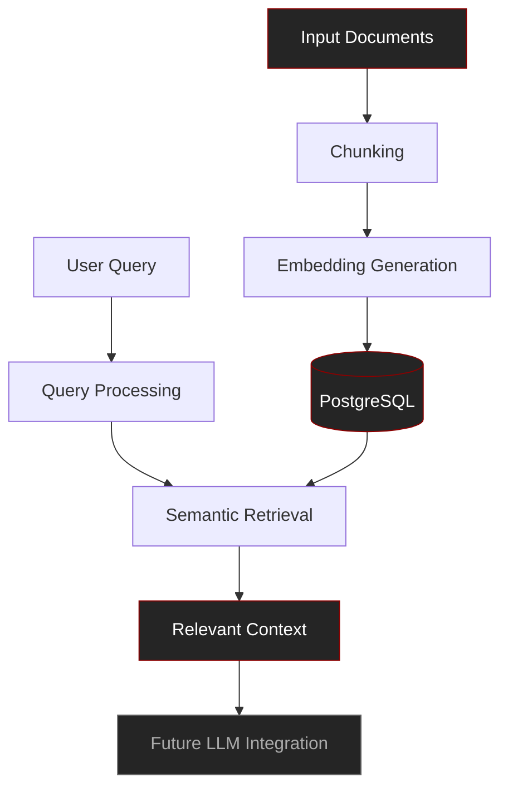

# 🔎 RAG SQL Injection

**Exploring Retrieval-Augmented Generation, databases, and application security.**

A hands-on project combining Python, PostgreSQL, vector embeddings, and web technologies to explore semantic retrieval and the security challenges surrounding database-driven applications.

 

---

## 📌 Overview

**RAG SQL Injection** is a learning project focused on understanding how a Retrieval-Augmented Generation (RAG) system can combine document processing, semantic search, relational databases, and a web interface.

The project explores the relationship between Python, SQL, PostgreSQL, and vector embeddings while developing a foundation for investigating database security and SQL injection vulnerabilities.

Rather than relying entirely on high-level abstractions, I am using this project to gain practical experience with the individual components and understand how they interact.

> **Current limitation:** An integrated Large Language Model (LLM) is not yet part of the application. The current work focuses on the retrieval pipeline and database components without requiring a paid external AI service.

## 🛠️ Technology Stack

<b>Python — Application Logic</b>

Python serves as the primary language for processing data and coordinating the application's components.

Its ecosystem provides tools for data manipulation, embedding generation, backend development, and database integration.

<b>PostgreSQL — Data Storage</b>

PostgreSQL is the relational database used to store and manage application data.

I designed and implemented the database and its SQL logic as part of the learning process.

The project uses PostgreSQL as the foundation for data persistence and retrieval.

<b>SQL — Database Interaction</b>

SQL is used to define database operations, retrieve information, and manage records.

Working directly with SQL helps me understand how application logic translates into database queries, which is particularly relevant when studying SQL injection and secure database interaction.

<b>Vector Embeddings — Semantic Representation</b>

Embeddings represent information as numerical vectors.

These representations allow a retrieval system to compare semantic similarity rather than relying exclusively on exact keyword matches.

The goal is to retrieve context that is relevant to a user's query.

<b>Flask — Backend</b>

Flask provides the Python web application layer, connecting the browser interface with the backend logic.

It allows the application to process requests and coordinate communication with the database.

<b>HTML — Web Interface</b>

HTML provides the browser-based interface through which users can interact with the application.

The interface communicates with the backend instead of accessing PostgreSQL directly.

## 🏗️ Architecture

The current implementation focuses on the retrieval side of the RAG architecture.

The final LLM integration represents a future development stage, not an existing feature.

### How the pipeline works

1. **Document processing:** Input data is divided into smaller chunks.
2. **Embedding generation:** The chunks are represented as numerical vectors.
3. **Storage:** The database stores the information required by the retrieval process.
4. **Semantic retrieval:** A query is used to find relevant information.
5. **Context preparation:** The retrieved information can later be passed to an LLM when that component is integrated.

## 🔐 Cybersecurity Focus

The repository's name reflects my interest in SQL injection and the security implications of database-driven applications.

SQL injection occurs when untrusted input is incorporated into SQL statements in an unsafe way, potentially allowing an attacker to alter the intended database query.

Through this project, I want to strengthen my understanding of:

- How applications construct and execute SQL queries.
- How Python communicates with PostgreSQL.
- Why parameterized queries are important for preventing SQL injection.
- How database design and backend architecture affect application security.
- How retrieval systems can be developed with security in mind.

The objective is to connect database development with practical application security rather than treating them as unrelated subjects.

## 🎯 Learning Objectives

- [x] Design and implement a PostgreSQL database.
- [x] Develop SQL logic for database operations.
- [x] Build a Python-based application foundation.
- [x] Develop a browser-based interface.
- [ ] Continue developing the retrieval pipeline.
- [ ] Improve database security and query handling.
- [ ] Expand practical SQL injection testing in a controlled environment.
- [ ] Integrate an LLM into the RAG pipeline.
- [ ] Develop additional security-focused features.

*Checklist items reflect the project's intended progression and should be updated as implementation evolves.*

## 📚 What This Project Represents

This repository is part of my broader journey into programming and cybersecurity.

It allows me to explore several areas simultaneously: backend development, relational databases, semantic retrieval, and secure software design.

My goal is to understand not only how to make these components work together, but also how their design decisions influence the security and reliability of the resulting application.

---

**Built to learn. Developed to understand. Designed with security in mind.**

